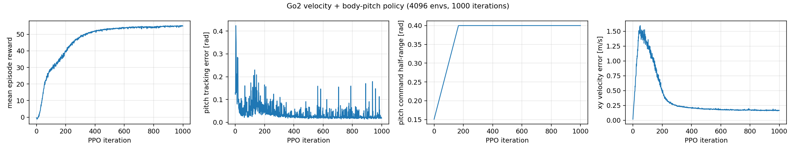
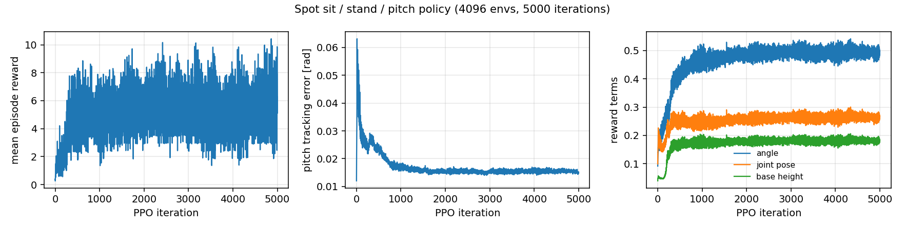

# Quadruped RL

Reinforcement-learning tasks for quadruped robots in Isaac Lab, trained with PPO (RSL-RL). Both tasks are registered as external Isaac Lab tasks, so nothing inside the Isaac Lab checkout is modified.

| Task | Robot | What the policy learns |
|---|---|---|
| [Velocity + body pitch](go2_pitch_tool/) | Unitree Go2 | Walk at a commanded velocity while holding a commanded body pitch (±0.4 rad) |
| [Sit / stand / pitch posture](spot_view_tool/) | Boston Dynamics Spot | Sit down, tilt the body to a commanded pitch and stand up again, fast enough to switch with a walking policy at runtime |

The posture policy was built for the IndustSim-Quad industrial inspection benchmark, where Spot has to stop, sit and tilt its body camera toward an inspection target, then stand up and keep walking.

## Go2: velocity and body-pitch tracking

The task inherits Isaac Lab's flat-terrain Go2 velocity task and adds a one-dimensional pitch command.

- **Command and observation:** a separate `body_pitch` command, resampled every 3–5 s; observation grows from 48 to 49 dimensions.
- **Reward:** the stock "keep the body level" term fights the pitch command, so it is replaced with a pitch-tracking term on the body-frame gravity vector and a roll-only penalty.
- **Curriculum:** the pitch range widens from ±0.15 rad to ±0.4 rad over the first ~170 iterations.



| 4,096 parallel environments, 1,000 iterations | Value |
|---|---|
| Training time (RTX 5090) | 6.4 min |
| Pitch tracking error, last 50 iterations | 0.03 rad at a ±0.4 rad command range |
| Planar velocity error, last 50 iterations | 0.17 m/s |
| Episodes that run the full 20 s without falling | 99.8% |

Details: [go2_pitch_tool/README.md](go2_pitch_tool/README.md).

## Spot: sit, stand and pitch posture

One command-conditioned policy covers sitting, standing and the transition between them. The command is `[posture, roll, pitch, yaw]`, with `posture` running from 0 (seated) to 1 (standing) along a sit–crouch–stand keyframe chain; training uses pitch only.

- **Three task versions:** a seated-pose task, a posture task with slow command changes, and a fast version that resamples commands every 0.6–1.2 s.
- **Reward:** pitch tracking, joint-pose and base-height tracking along the keyframe chain, foot contact, and penalties on foot penetration, contact force, action rate and joint torque.
- **Runtime switching:** the trained policy is exported to TorchScript and swapped with Isaac's Spot walking policy in one simulation: walk, stop, sit and look, stand, walk on ([walk_then_sit_policy_switch.py](spot_view_tool/scripts/walk_then_sit_policy_switch.py)).



| 4,096 parallel environments, 5,000 iterations | Value |
|---|---|
| Training time (RTX 5090) | 82 min |
| Pitch tracking error, last 50 iterations | 0.015 rad over a −0.45 to 0.15 rad command range |
| Sit and stand transition used at runtime | 0.8 s each |

Details: [spot_view_tool/README.md](spot_view_tool/README.md).

## Run

Tested with Isaac Sim 5.1, Isaac Lab 2.3.2 and rsl-rl-lib 5.0.1.

```bash
git clone https://github.com/juhwan0423/quadruped-rl.git
export REPO=$PWD/quadruped-rl
export ISAACLAB_PATH=/path/to/IsaacLab
cd $ISAACLAB_PATH
```

Quick check on CPU (a few seconds of training):

```bash
./isaaclab.sh -p $REPO/go2_pitch_tool/scripts/train_go2_pitch.py --headless --device cpu --num_envs 2 --max_iterations 1
```

Full training runs:

```bash
./isaaclab.sh -p $REPO/go2_pitch_tool/scripts/train_go2_pitch.py --headless --device cuda:0 --num_envs 4096 --max_iterations 1000
```

```bash
./isaaclab.sh -p $REPO/spot_view_tool/scripts/train_posture_fast.py --headless --device cuda:0 --num_envs 4096 --max_iterations 5000 --run_name fast_mvp
```

Checkpoints are written to `IsaacLab/logs/rsl_rl/<experiment>/<run>/`.

## Trained policy

[policies/](policies/) holds the Spot posture policy from the run above: the RSL-RL checkpoint and its TorchScript export. The walk–sit–stand demo also needs Isaac's Spot walking policy (`spot_policy.pt`), which is not included here; pass it with `--walk-policy`.

```bash
./isaaclab.sh -p $REPO/spot_view_tool/scripts/walk_then_sit_policy_switch.py --device cuda:0 --walk-policy /path/to/spot_policy.pt
```
